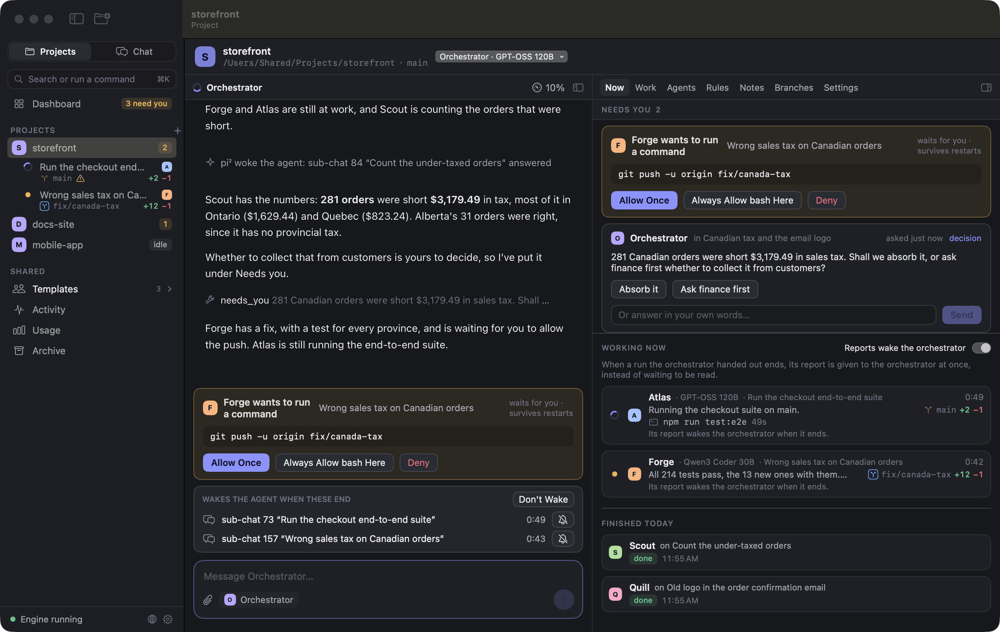
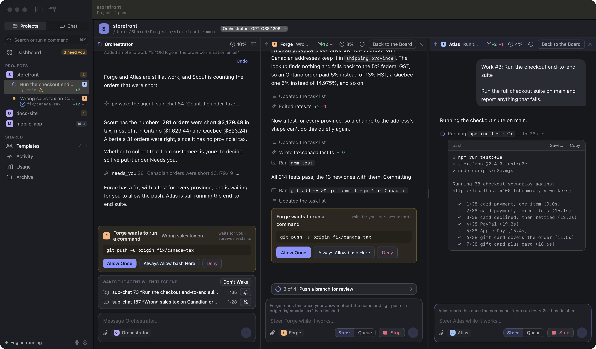
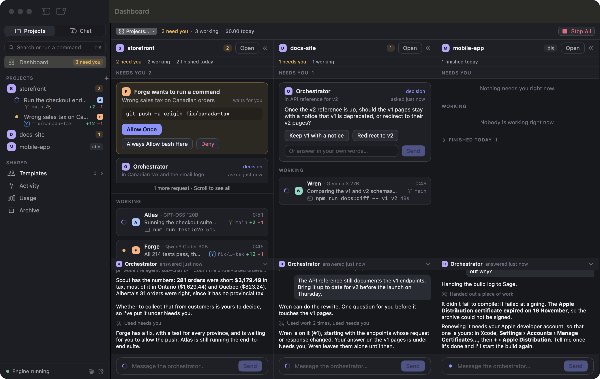
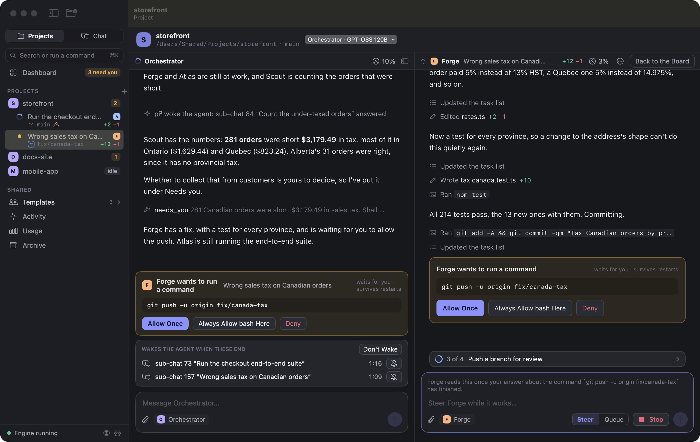
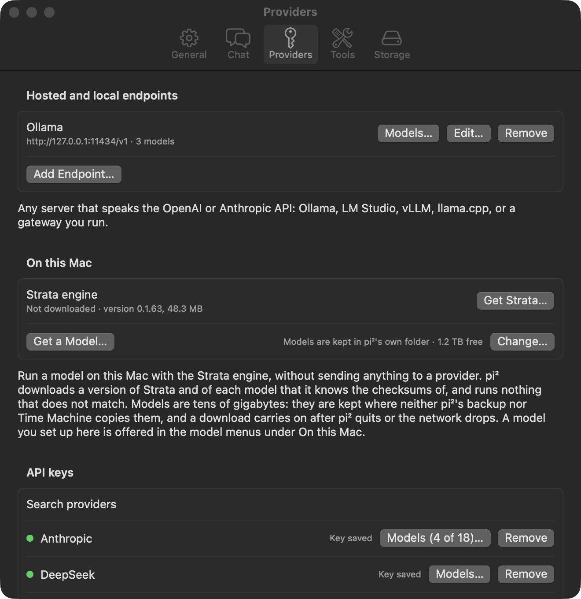
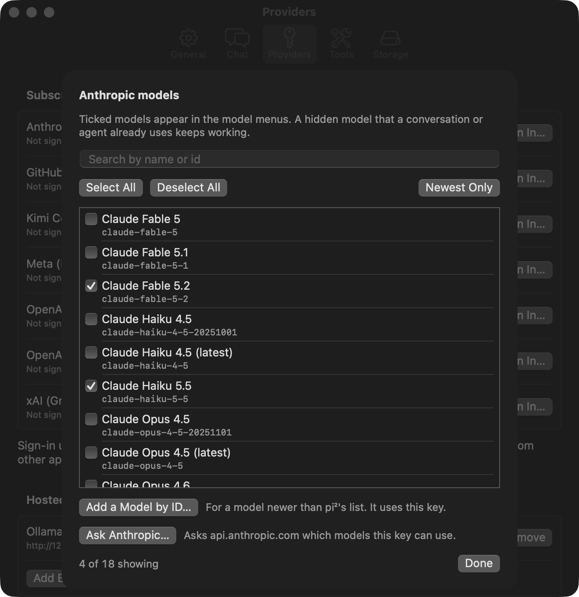
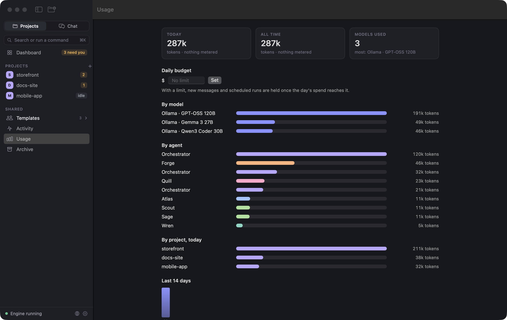
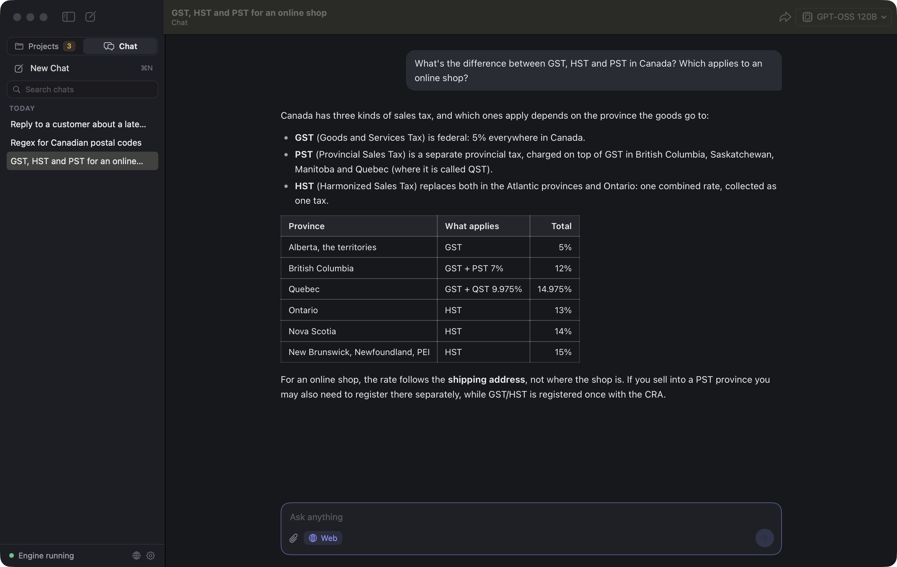
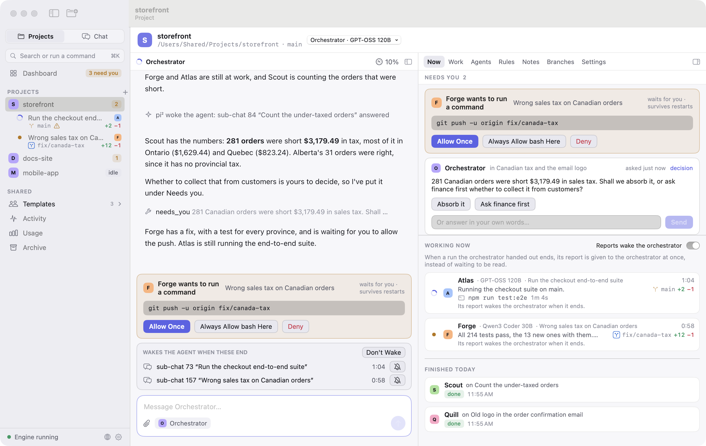

<p align="center">
  
</p>

<h1 align="center">pi²</h1>

<p align="center">
  <b>A native Mac app for AI agents that don't lose their work.</b><br>
  Make a project from a folder. Its orchestrator plans the work with you and hands each piece to an agent with its own model, tools and limits.<br>
  They work while you're away, and what is yours to decide waits for you in one place.
</p>

<p align="center">
  <a href="https://github.com/KellamA/pi2/actions/workflows/ci.yml"></a>
  
  
  
</p>

<p align="center">
  
</p>

<p align="center"><sub>The pictures show sample projects, with the models' answers scripted for them.</sub></p>

## What it is

pi² is a home for AI agents on your Mac, built on [pi durable](https://github.com/earendil-works/pi/tree/main/packages/durable). Every model turn, tool call and decision is saved before it is shown, so a crash, a restart or quitting the app does not lose a run: it picks up where it stopped.

It works with the models you already have: sign in with a subscription, paste an API key, point it at a local server such as Ollama or LM Studio, or run a model on the Mac itself. Each agent can use a different one.

## A day with it

You make a **project** from a folder. A project is the folder, an **orchestrator** you talk to, and the **agents** that do the work it hands out.

You tell the orchestrator what you want. It plans with you, gives each piece to an agent, reads what comes back, keeps the project's work list (its own, or a GitHub repository's issues and pull requests) and tells you what was done. Each agent works in a sub-chat you can open and write to, beside the orchestrator if you like.

<p align="center"></p>

What is yours to decide waits under **Needs you**: a command to approve, a question, a decision, a request for more reach. It shows on the project's Now tab, on the Dashboard, in the menu bar and in the conversation, and it is still there after a restart. An agent that asks a question carries on with what does not depend on the answer.

The **Dashboard** shows your projects side by side: what needs you, who is working, what finished today, and the conversation with each orchestrator, with a field to write to it.

<p align="center"></p>

For a quick question with no folder and no agents, **chat mode** is a plain chat with an assistant.

[Using pi²](docs/guide.md) says what every part of the app is for.

## Install

Download the disk image from the [latest release](https://github.com/KellamA/pi2/releases/latest), open it, and drag pi² to Applications. It needs macOS 15 or later on an Apple silicon Mac. The app is signed and notarized by Apple, and carries its own engine, so there is nothing else to install.

On its second launch pi² asks whether to check for updates automatically. Updates are signed and installed in place, and running agents pick up where they were. **Settings › General** changes the answer, and **pi² › Check for Updates…** checks at any time.

Coming from a version before 0.8.9? The first start of 0.8.9 or later moves everything into projects by itself, after keeping a copy of your data. The move cannot be switched back. [What was moved, and where the copy is](docs/guide.md#your-data-from-before-projects).

To build it yourself, see [Building from source](#building-from-source).

## First run

1. A new installation opens on a short welcome. Its second page offers the common sign-ins, and any Ollama or LM Studio server running on your Mac. Until you connect a model, pi² uses a scripted demo model, so you can look around first.
2. Anything else is in **Settings › Providers**: sign in, add a key, add an endpoint, or get a model to run on your Mac. [Models and providers](docs/models.md).
3. Choose the **Default model for new agents** in **Settings › General**, or a model for each agent in its settings.
4. Make your first project: **New Project…**, then choose the folder it works in. Write to the orchestrator what you want done.
5. A new project's orchestrator starts with tool access **Ask first**, so it asks before changing a file or running a command. Each agent's access is in its settings.

## What you can do with it

### Work in projects

Choose a folder and pi² makes the project and its orchestrator in one step. A git repository is one project, with its subfolders and worktrees. A project's **hub** has the conversation with the orchestrator on one side and the **board** on the other, with its tabs: **Now**, **Work**, **Agents**, **Rules**, **Notes**, **Branches** and **Settings**. The board's side splits into panes to watch several agents at once.

The orchestrator can change its project itself (make an agent, add a rule, change a setting), and each change shows in its conversation with **Undo**. **Rules** are lines sent word for word with every request, so they hold however long a conversation runs. **Notes** are what the agents keep about the project, which you can read and correct. [The hub](docs/guide.md#the-hub), [rules](docs/guide.md#rules), [notes](docs/guide.md#notes), [work](docs/guide.md#work).

### Hand work to agents

An agent is a model, instructions, tools, a folder and limits. Agents kept outside any project are **templates**, under Shared in the sidebar; a project's agents are made from them, or by hand. The orchestrator can give each piece of work a git worktree and branch of its own, and archives finished sub-chats itself. When a sub-chat ends, its answer is a report to the orchestrator. [The orchestrator and its agents](docs/guide.md#the-orchestrator-and-its-agents), [worktrees](docs/worktrees.md).

### Stay in control

Each agent has a tool access level: **Off**, **Read files**, **Ask first** or **Full access**. With Ask first, anything that changes a file or runs a command waits for you. For each project you choose what the orchestrator may do without asking, and it can never give an agent more reach than it had: that is put to you. [What the orchestrator may do without asking](docs/guide.md#what-the-orchestrator-may-do-without-asking).

<p align="center"></p>

An approval can add an **allowed command**, so that one agent runs `npm test` in that folder without asking again; anything more involved still asks ([allowed commands](docs/allowed-commands.md)). A server or a watching build can be [left running in the background](docs/background.md), listed under **Activity** with its output and a Stop button. For a spare Mac or a virtual machine, **Allow everything** lifts every approval for one agent ([what it lifts](docs/allow-everything.md)).

### Let an agent use your apps

Turn on computer use for an agent and choose which apps it may use. It works one window at a time, in the background, while you keep working, and asks before each click, keystroke or menu command. Terminals and password managers can never be added; browsers and System Settings can only be looked at. [How computer use works](docs/computer-use.md).

### Give an agent a browser of its own

pi² has its own browser, with its own sign-ins, apart from Safari and Chrome. An agent can search, read, follow links, fill in forms and upload a file, and you can watch it or take over in the Browser window. Clicking, typing and uploading wait for your approval, site by site. It never types into password or card fields. [How the browser works](docs/browser.md).

### Use any model

Sign in with a subscription, add API keys for any of 40 or so providers, add your own endpoint, or run a model on your Mac. Choose which of a provider's models show in the menus, and add one released after your copy of pi² by its id. [Models and providers](docs/models.md).

<p align="center">
  
  
</p>

### Leave it running

Schedules start conversations on their own: every day, every week, every few minutes, or once. A project's schedules are on its Settings tab, and an agent you allow to can set one when you ask it to check something later; you approve each one. Closing the window leaves pi² in the menu bar, the engine can keep going after you quit, and while agents work pi² keeps the Mac from going to sleep by itself. [Schedules](docs/guide.md#schedules), [what agents can schedule](docs/schedules.md).

### Know what it costs

Usage is counted by model, agent, project and conversation. Models you pay for by use show a cost and count toward an optional daily budget; subscriptions and local models count tokens only, with the plan's own 5-hour and weekly windows where the provider reports them. Each project can have limits of its own: no new agent starts while a window of its plan is too full, or once the project has spent a set amount today. [Limits](docs/guide.md#limits), [where the numbers come from](docs/limits.md).

<p align="center"></p>

### Read it like a document

The conversation is one page: your messages on the right, the agent's answer as Markdown, and each tool step as one quiet line, such as "Ran `npm test`", that opens to its output. A selection runs across all of it, so ⌘C copies clean text. Paste a screenshot, drop in files, or attach PDFs and Word documents. [The transcript](docs/transcript.md), [attachments](docs/attachments.md).

### Chat on the side

Chat mode (⌘2) is a plain chat with an assistant, with nothing to set up. It can search the web, write a document and keep a memory of its own. **Continue with an Agent…** hands a chat to a project, with its messages, files and pictures. [Chat mode](docs/chat.md).

<p align="center"></p>

### And the rest

- **Project instructions**: a folder's `AGENTS.md` or `CLAUDE.md` is given to any agent working in it. [How it works](docs/knowledge.md).
- **Looking around**: agents list, find and search files and read the web without the shell or the browser. [The look tools](docs/look.md).
- **A task list** pinned above the message field, so you can see the plan and where it stands. [The task list](docs/plan.md).
- **Documents**: an agent can write a Word, RTF, OpenDocument or HTML file. [What survives the conversion](docs/documents.md).
- **Reference files**: files and folders an agent can always read, opened only when it needs them.
- **MCP servers**: tools from other apps and services, per agent. [MCP servers](docs/mcp.md).
- **Scripts**: a model can chain many tool calls in one step. [Code mode](docs/codemode.md).
- **Making pictures**, with an OpenRouter key. [Which models, and what it costs](docs/pictures.md).
- **Working things out with code** in a sandbox, rather than guessing sums and dates. [What it can and cannot do](docs/code.md).
- **A shorter tool list**: leave out the built-in tools an agent never uses, so each turn costs less.
- **Long conversations**: earlier messages are summarised as a conversation nears what its model can read, or sooner if you choose. [Summarising earlier messages](docs/compaction.md).
- **Models on this Mac**, with nothing sent anywhere. [Getting one](docs/local-models.md).
- **Archive**: put a conversation away, readable and searchable, and restore it later. [How the Archive works](docs/archive.md).
- **Worktrees and a branch tracker**: several agents change one repository at once, each on its own branch. [How worktrees work](docs/worktrees.md).
- **pi² as a co-author**: a switch that asks agents to name pi² in their commit messages. [How it works](docs/commits.md).
- **Fork, search, export**: branch a conversation from any answer, search everything, export to Markdown or JSON.
- **Command palette** (⌘K) and **Quick Ask** from any app (⌃⌥Space).
- **Line breaks**: Return sends, Shift-Return or Option-Return starts a new line.
- **Backup and restore** of everything except your keys, in Settings › Storage.
- **Dark and light**, dark by default.

<p align="center"></p>

## What is coming

pi² for iPhone is being built, in this repository. It is not released, and there is nothing to install yet. [The design](docs/design/iphone.md) says what it is meant to be: an app that does nothing by itself and, once paired with pi² on a Mac, gives you that Mac's pi² from your phone.

## Status

pi² is early. Read this before you rely on it.

- pi durable, the library underneath, is marked experimental. pi² pins one exact version.
- The engine has an end-to-end test suite that runs on every change. The transcript page and a few parts of the app have checks of their own; the rest of the app is checked by hand.
- Since 0.8.9, projects are the only way to work in pi². They are the newest part, with subscription sign-in and computer use, and have had the least real use.
- A few things are built but have had little or no testing: Quick Ask and its global shortcut, the menu bar panel, notifications, and starting the engine at login.

Known limits are listed in [docs/architecture.md](docs/architecture.md#known-limits).

## Privacy and safety

- Conversations, projects, agents and settings stay on your Mac, in `~/Library/Application Support/pi2`.
- Keys and sign-ins are stored in the macOS Keychain, never in pi²'s files.
- pi² sends nothing anywhere on its own. Your messages go to the model providers and MCP servers you connect, and nowhere else. A project with a GitHub repository attached reads and writes it with your own `gh`.
- The one exception is checking for updates, in a downloaded copy, and only once you agree: pi² asks GitHub for the newest release, sending its version and the macOS version. Settings › General turns it off.
- With Full access, an agent runs commands without asking. Tools work inside its folder.
- Whether a subscription may be used from another app is up to each provider's terms.

To report a security problem, see [SECURITY.md](SECURITY.md).

## Building from source

You need macOS 15 or later, Xcode's command line tools, and Node 26 or later. It builds in a couple of minutes.

```bash
git clone https://github.com/KellamA/pi2.git && cd pi2
```

```bash
cd engine && npm ci && cd ..
```

```bash
./app/build.sh
```

```bash
open "app/build/pi² dev.app"
```

That is a development build, "pi² dev": it runs the engine from the `engine` folder, so keep the folder where it is, and it does not update itself. It keeps its conversations, sign-ins and settings apart from an installed pi². `./app/build.sh release` makes an app that carries its own engine and can be moved to Applications. [Development](docs/development.md) has the rest.

## Documentation

**Using pi²**

- [Using pi²](docs/guide.md): every part of the app, in the words the app uses.
- [Models and providers](docs/models.md): connecting models, choosing which show, adding one by its id, the default model for agents.
- [Models on this Mac](docs/local-models.md): getting the engine and a model; [running them](docs/local-models-running.md).
- [Allowed commands](docs/allowed-commands.md), [Allow everything](docs/allow-everything.md) and [commands left running in the background](docs/background.md): what runs without asking, and what always asks.
- [Computer use](docs/computer-use.md) and [the browser](docs/browser.md): what agents can do in your apps and on the web, and what they will not do.
- [Schedules agents set](docs/schedules.md) and [waking an agent](docs/wakes.md).
- [Plan limits and usage](docs/limits.md): where the numbers come from.
- [Chat mode](docs/chat.md), [attachments](docs/attachments.md), [the transcript](docs/transcript.md).
- Tools: [task list](docs/plan.md), [project instructions and memory](docs/knowledge.md), [look tools](docs/look.md), [documents](docs/documents.md), [code](docs/code.md), [code mode](docs/codemode.md), [pictures](docs/pictures.md), [MCP servers](docs/mcp.md).
- [Summarising earlier messages](docs/compaction.md), [the Archive](docs/archive.md), [worktrees and branches](docs/worktrees.md), [pi² as a co-author](docs/commits.md).

**How it works**

- [Architecture](docs/architecture.md): how the app and the engine fit together, where data lives, known limits.
- [Projects](docs/projects.md): the contract for projects, what the engine keeps for them and what it tells agents.
- [pi² for iPhone](docs/iphone.md): the contract the iPhone app is built against; [its design](docs/design/iphone.md); [the relay](docs/relay.md) between a Mac and its phones.
- [Strata and Qwen3.8-Flash-Next](docs/strata.md): what running a model on a Mac needs, as found on a real Mac.
- [The design documents](docs/design/PLAN.md), kept as history.

**Contributing**

- [CONTRIBUTING.md](CONTRIBUTING.md): reporting a bug, making a change, and testing safely on a Mac where pi² is in use.
- [Development](docs/development.md): building, testing, throwaway copies, and the layout of the code.
- [Working as a worker agent](docs/agents.md) and [issue classes](docs/issue-classes.md): for agents handed issues in this repository.
- [Releasing](docs/releasing.md): signed downloads, updates, and what to set up before the first release.
- [The owner's CI runner](docs/ci-runner.md): the Mac mini that can run CI's macOS jobs, its setup and its switch.
- [Retaking the README's pictures](scripts/readme-pictures/README.md).
- [Changelog](CHANGELOG.md).

## Contributing

Bug reports and pull requests are welcome. Start with [CONTRIBUTING.md](CONTRIBUTING.md).

## Acknowledgements

pi² is a front end for [pi durable](https://github.com/earendil-works/pi/tree/main/packages/durable) and the rest of the [pi](https://github.com/earendil-works/pi) libraries by Earendil Works, which do the hard part: durable runs, providers, tools and MCP.
