<p align="center">
  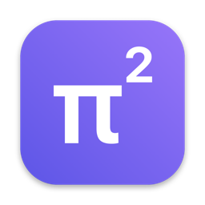
</p>

<h1 align="center">pi²</h1>

<p align="center">
  <b>A native Mac app for AI agents that don't lose their work.</b><br>
  Give each agent its own model, tools and limits. Let them hand work to each other, use your apps, and run while you're away.<br>
  Approve what matters from one inbox.
</p>

<p align="center">
  <a href="https://github.com/KellamA/pi2/actions/workflows/ci.yml"></a>
  
  
  
</p>

<p align="center">
  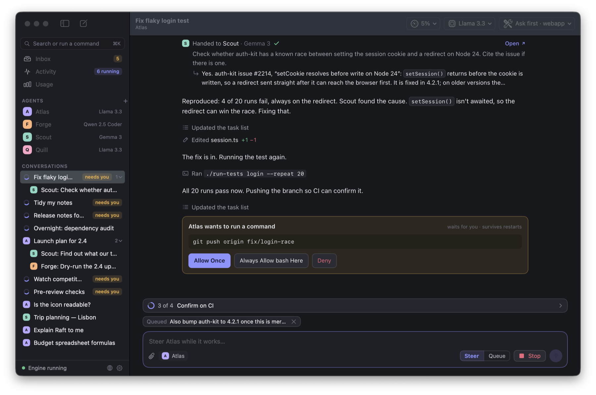
</p>

<p align="center"><sub>The screenshots show sample conversations, with answers and usage figures scripted for the pictures.</sub></p>

## What it is

pi² is a home for agents on your Mac, built on [pi durable](https://github.com/earendil-works/pi/tree/main/packages/durable). Every model turn, tool call and decision is saved before it is shown, so a crash, a restart or quitting the app does not lose a run. It picks up where it stopped.

It works with the models you already have: sign in with a subscription, paste an API key, or point it at a local server such as Ollama or LM Studio. Each agent can use a different one.

## What you can do with it

### Run a team of agents

An agent is a saved setup: a model, instructions, tools, a folder, and limits. Pick one to start a conversation.

<p align="center">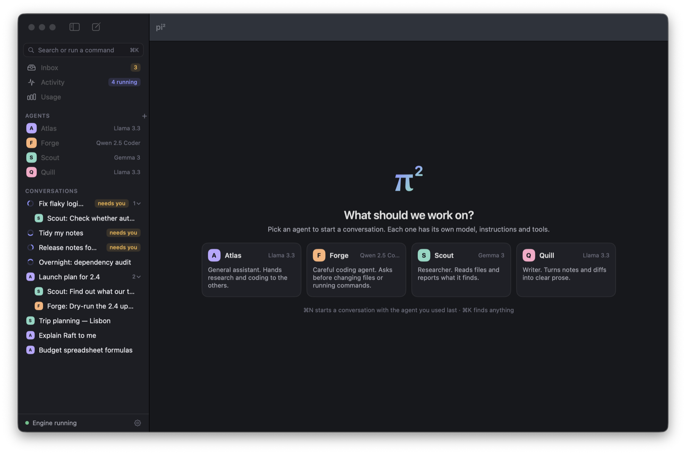</p>

Agents can hand work to each other. Each handoff opens a sub-chat under the conversation that started it, so you can watch an orchestrator's helpers work, open any of them, and talk to them directly.

<p align="center">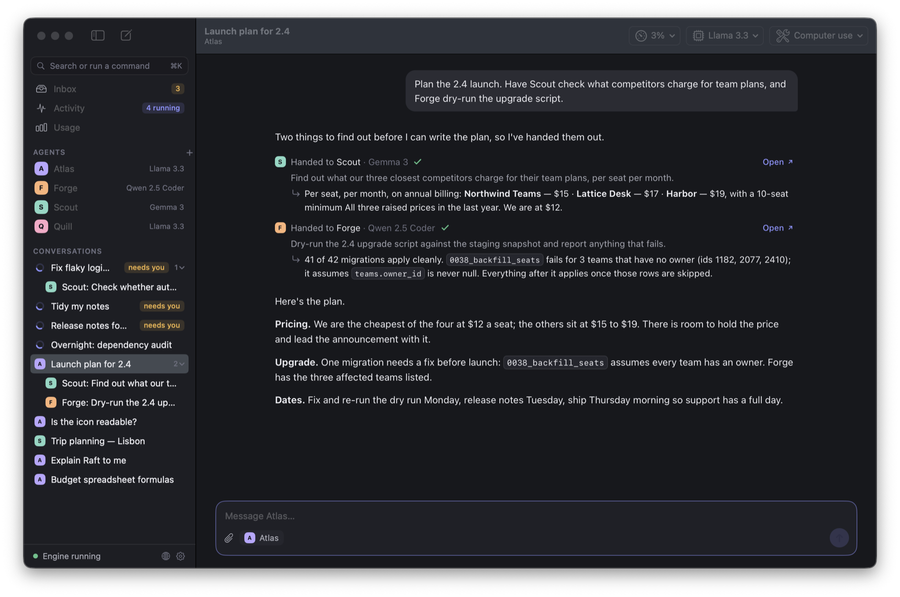</p>

### Stay in control

Tool access is set per conversation: off, read only, ask first, or full. With "ask first", anything that changes a file or runs a command waits for you. Approvals and questions from every conversation collect in one Inbox, and they are still there after a restart.

<p align="center">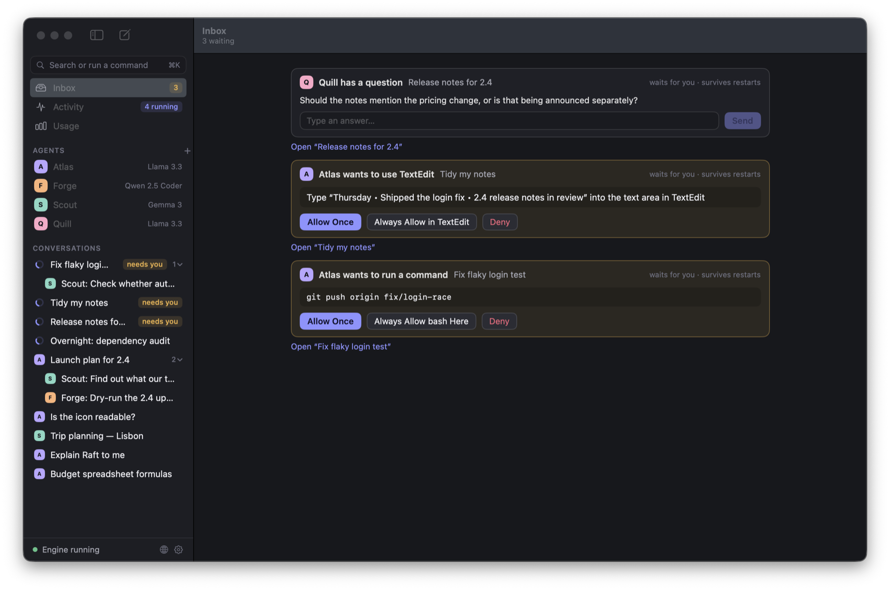</p>

Being asked about every `git status` gets old, and switching approvals off for the whole shell gives too much away. So an approval for a command offers a third choice: allow commands that start the same way, for that agent in that folder, from now on. Anything more involved still asks: two commands joined together unless each is covered, writing to a file, a variable, `sudo`. Rules that would allow anything, such as `bash` or `rm` on their own, cannot be made. You can review and remove rules in the agent's settings. [What a rule covers](docs/rules.md).

<p align="center">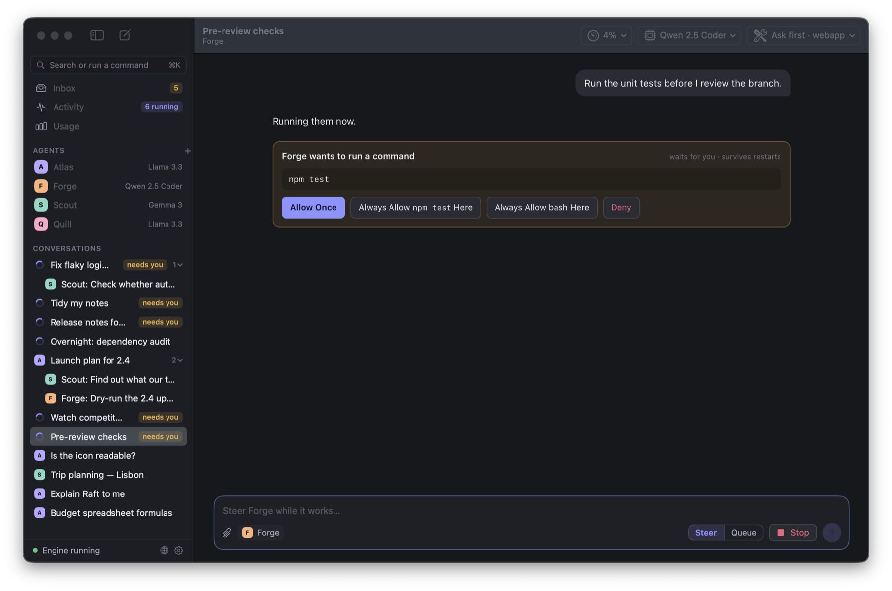</p>

### Let an agent use your apps

Turn on computer use for an agent and choose which apps it may use. It works one window at a time, in the background, while you keep working. It reads the window's buttons and fields, and sees a picture of it if its model can. Before it clicks, types or picks a menu command, it tells you what it is about to do and waits.

<p align="center">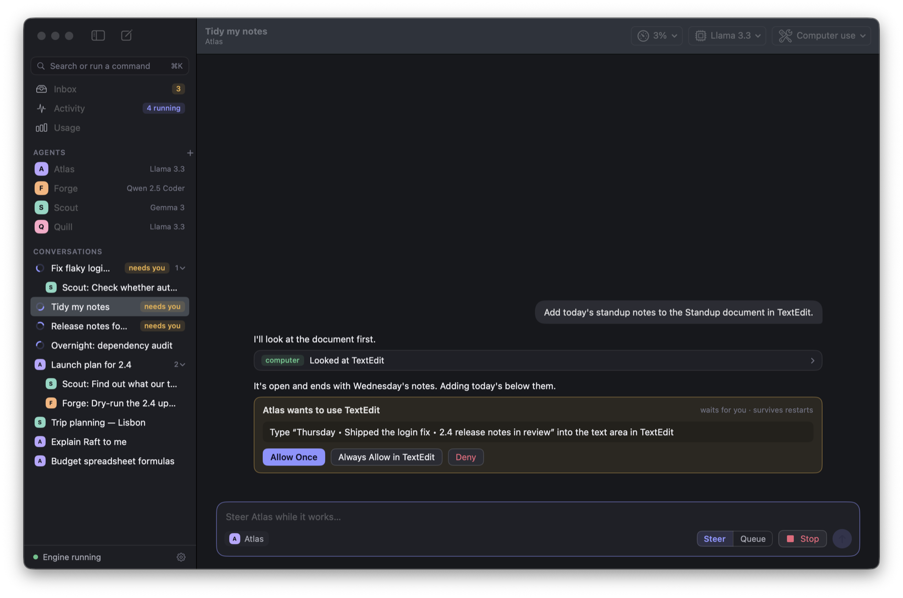</p>

Terminals and password managers can never be added. Browsers and System Settings can be looked at but not controlled. [How computer use works](docs/computer-use.md).

<p align="center">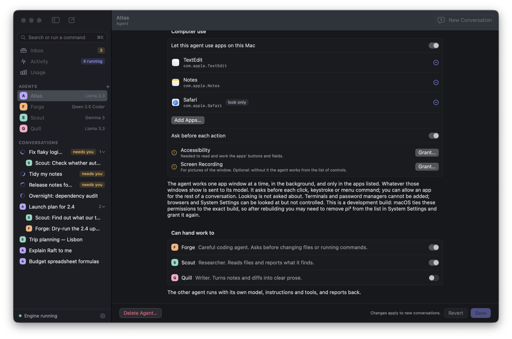</p>

### Give an agent a browser of its own

pi² has its own browser, with its own sign-ins, separate from Safari and Chrome. An agent can open pages, search, read, follow links, fill in forms and upload a file; you can watch in the Browser window, sign in to a site yourself, solve a CAPTCHA, or take over. Reading and following links is free. Clicking buttons, typing and uploading wait for your approval, site by site. It never types into password or card fields, and cannot reach addresses on your own machine or network. [How the browser works](docs/browser.md).

### Use any model

Sign in with a subscription, add API keys for any of 40 or so providers, or add your own endpoint. Choose which of a provider's models show up in the menus: search the list by name or id, untick everything and pick the few you want, or let "Newest Only" keep one of each family.

<p align="center">
  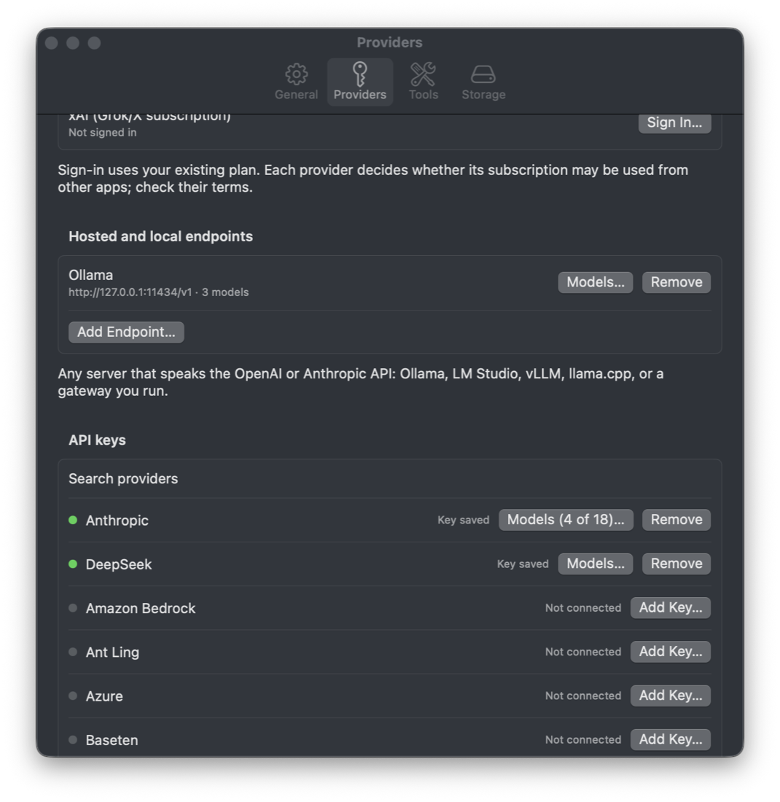
  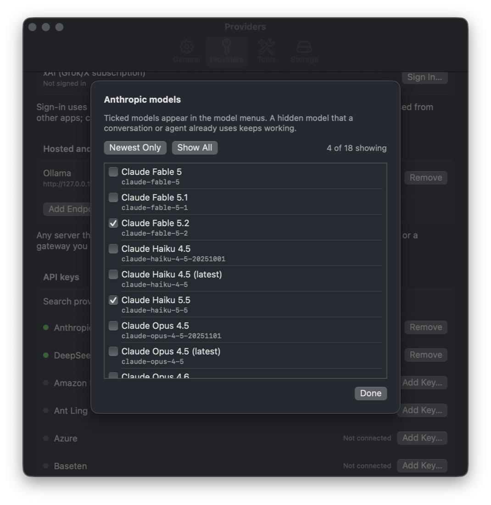
</p>

### Leave it running

Schedules start conversations on their own: every morning, every hour, or once at a set time. An agent you allow to can set one for itself when you ask it to check something later or regularly, and you approve each one before it exists. [What agents can schedule](docs/schedules.md). Activity shows what is running and what is waiting for you. Closing the window leaves pi² in the menu bar, and the engine can keep going after you quit.

<p align="center">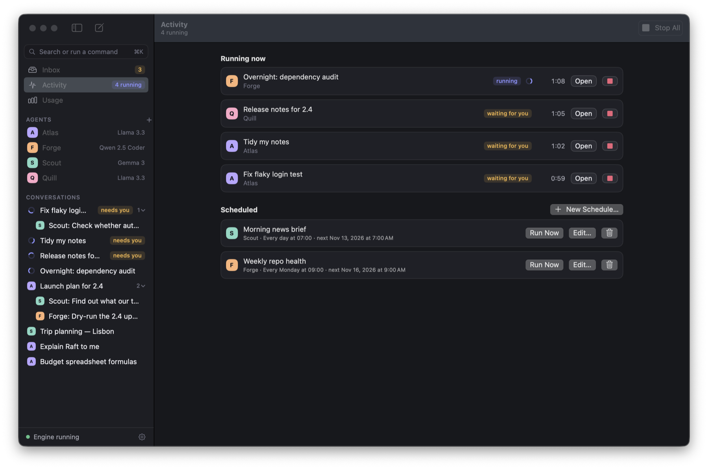</p>

### Know what it costs

Usage is counted by model, agent and conversation. Models you pay for by use show a cost and count toward an optional daily budget; subscriptions and local models count tokens only.

For a subscription you are signed in to, Usage also shows the plan's own limits where the provider reports them: how much of the 5-hour and weekly windows is used, and when each resets. [Where the numbers come from](docs/limits.md).

<p align="center">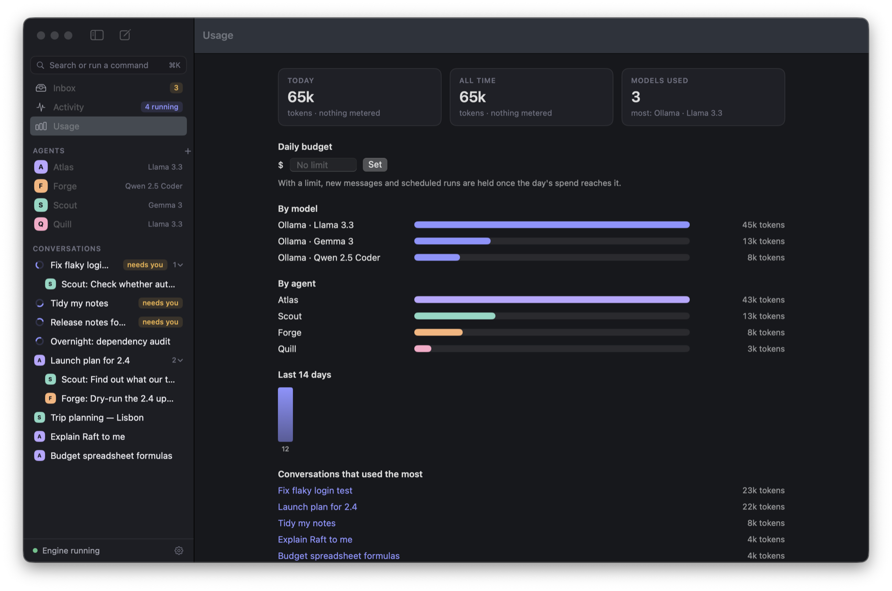</p>

### Read it like a document

The conversation is one page, laid out the way Claude Code lays out a session: your messages on the right, the agent's answer as plain text with full Markdown (headings, lists, tables, code with a Copy button), and each tool step as one quiet line such as "Ran `npm test`" or "Edited session.ts +3 −2" that opens to the command's output or the change. Approvals and questions appear where the agent stopped, and hand-offs show the other agent's answer.

Because it is one page, a selection runs across everything: drag from a paragraph through tool steps and a code block, press ⌘C, and what you paste is clean text. ⌘A then ⌘C copies the whole conversation. [How the transcript is built](docs/transcript.md).

<p align="center">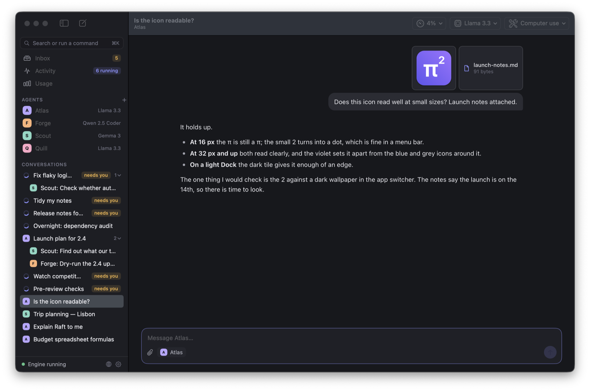</p>

Paste a screenshot, drop in files, or attach PDFs and Word documents; pictures show in the conversation and open larger when clicked. [What can be attached](docs/attachments.md).

### And the rest

- **Project instructions**: a folder's `AGENTS.md` or `CLAUDE.md` is given to any agent working in it.
- **Memory**: switch it on for an agent and it keeps short notes between conversations, which you can read, edit and delete in its settings. [How both work](docs/knowledge.md).
- **Looking around**: agents can list, find and search files in their folder without the shell, and fetch a page or search the web without the browser, even on a schedule with the app closed. [The look tools](docs/look.md).
- **A task list**: for work with several steps, the agent keeps a checklist pinned above the message field, so you can see the plan and where it stands.
- **Documents**: ask for a report or a letter and the agent can write it as a Word, RTF, OpenDocument or HTML file. [What survives the conversion](docs/documents.md).
- **Reference files**: give an agent files and folders it can always read, including Word and RTF documents. It opens them when it needs them, so they cost nothing until then.
- **MCP servers**: add tools from other apps and services, per agent.
- **Scripts**: let a model chain many tool calls in one step.
- **Archive**: put a conversation away without losing it. It leaves the sidebar, stays readable and searchable, and can be restored; pi² can archive what has gone unused for a while on its own. [How the Archive works](docs/archive.md).
- **Worktrees and a branch tracker**: let several agents change one git repository at once, each in a worktree of its own on its own branch. Every conversation in a repository shows its branch in the sidebar, coloured by how it stands: changes, commits to push or merge, merged, conflicts. [How worktrees work](docs/worktrees.md).
- **Fork, search, export**: branch a conversation from any answer, search everything, export to Markdown or JSON.
- **Command palette** (⌘K) and **Quick Ask** from anywhere (⌃⌥Space).
- **Backup and restore** of everything except your keys.
- **Dark and light**, dark by default.

<p align="center">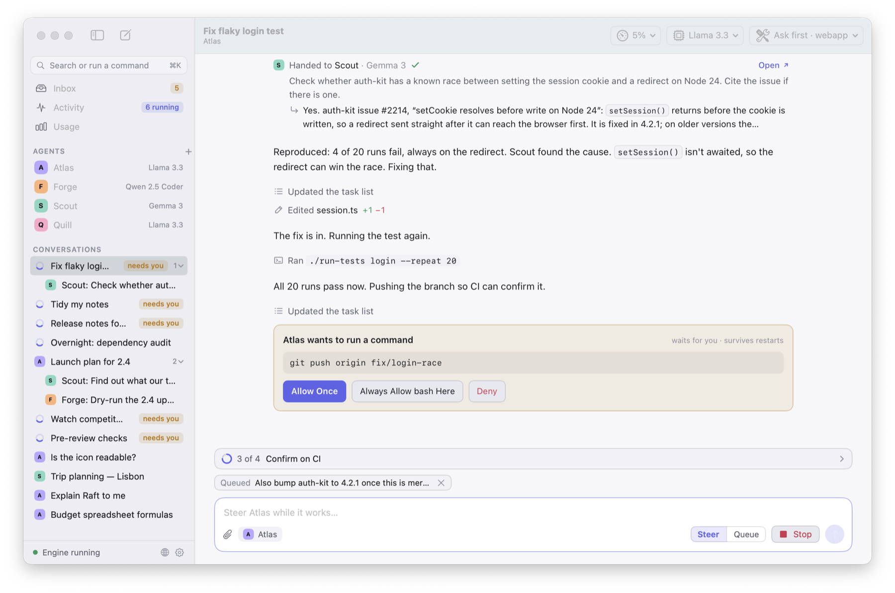</p>

## Install

There is no download yet: signed releases are set up but none has been published ([how releases are made](docs/releasing.md)). Until then, pi² builds from source in a couple of minutes.

You need macOS 15 or later, Xcode's command line tools, and Node 26 or later.

```bash
git clone https://github.com/KellamA/pi2.git && cd pi2
```

```bash
cd engine && npm ci && cd ..
```

```bash
./app/build.sh
```

```bash
open "app/build/pi².app"
```

That is a development build: it runs the engine from the `engine` folder, so keep the folder where it is. For an app that carries its own engine and can be moved to Applications:

```bash
./app/build.sh release
```

## First run

1. pi² opens with a scripted demo model, so you can click around before connecting anything.
2. Open **Settings › Providers** and sign in, add a key, or add an endpoint. If Ollama or LM Studio is running, the welcome screen offers to add it for you.
3. Pick a model from the toolbar of a conversation, or set one per agent.
4. To let an agent touch files, set **tool access** in the conversation's toolbar and choose a folder. Start with "Ask first".

## Status

pi² is early. Read this before you rely on it.

- pi durable, the library underneath, is marked experimental. pi² pins one exact version.
- The engine has an end-to-end test suite that runs on every change, and the transcript page has tests of its own. The rest of the app has no automated tests; it is checked by hand.
- Subscription sign-in and computer use are the newest parts and have had the least real use.
- A few things are built but have had little or no testing: Quick Ask and its global shortcut, the menu bar panel, notifications, and starting the engine at login.
- Releases are set up to be signed, notarized and updated in place, but none has been published yet. Updating has only been tried against a test feed on this Mac.

Known limits are listed in [docs/architecture.md](docs/architecture.md#known-limits).

## Privacy and safety

- Conversations, agents and settings stay on your Mac, in `~/Library/Application Support/pi2`.
- Keys and sign-ins are stored in the macOS Keychain, never in pi²'s files.
- pi² sends nothing anywhere on its own. Your messages go to the model providers and MCP servers you connect, and nowhere else.
- The one exception is checking for updates, in a downloaded copy, and only once you agree: pi² asks GitHub for the newest release, sending its version and the macOS version. Settings › General turns it off.
- With "Full access", an agent runs commands without asking. Tools work inside the conversation's folder.
- Whether a subscription may be used from another app is up to each provider's terms.

To report a security problem, see [SECURITY.md](SECURITY.md).

## Documentation

- [Architecture](docs/architecture.md): how the app and the engine fit together, where data lives, known limits.
- [Computer use](docs/computer-use.md): how it works, what it will not do, how to try it safely.
- [Browser](docs/browser.md): the agents' own browser, what it asks about, and what it will not do.
- [Attachments](docs/attachments.md): what can be pasted or attached to a message, and the limits.
- [Transcript](docs/transcript.md): how the conversation page is built, and how it is kept from running anything a model writes.
- [Task list](docs/plan.md), [project instructions and memory](docs/knowledge.md), [look tools](docs/look.md), [plan limits](docs/limits.md), [documents](docs/documents.md).
- [Command rules](docs/rules.md) and [schedules agents set](docs/schedules.md): what each allows, and what always asks.
- [Archive](docs/archive.md): archiving, restoring, and how deleting differs.
- [Worktrees and branches](docs/worktrees.md): working on one repository in parallel, and what the branch colours mean.
- [Development](docs/development.md): building, testing, and the layout of the code.
- [Releasing](docs/releasing.md): signed downloads, updates, and what to set up before the first release.
- [Changelog](CHANGELOG.md)
- [The original plan and mockups](docs/design/PLAN.md)

## Contributing

Bug reports and pull requests are welcome. Start with [CONTRIBUTING.md](CONTRIBUTING.md).

## Acknowledgements

pi² is a front end for [pi durable](https://github.com/earendil-works/pi/tree/main/packages/durable) and the rest of the [pi](https://github.com/earendil-works/pi) libraries by Earendil Works, which do the hard part: durable runs, providers, tools and MCP.
