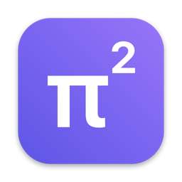

<p align="center">
  
</p>

<h1 align="center">pi²</h1>

<p align="center">
  <b>A native Mac app for AI agents that don't lose their work.</b><br>
  Make a project from a folder. Its orchestrator plans the work with you and hands each piece to an agent with its own model, tools and limits.<br>
  They work while you're away, and what is yours to decide waits for you in one place.
</p>

<p align="center">
  <a href="https://github.com/KellamA/pi2/actions/workflows/ci.yml"></a>
  
  
  
</p>

## What it is

pi² is a home for agents on your Mac, built on [pi durable](https://github.com/earendil-works/pi/tree/main/packages/durable). Every model turn, tool call and decision is saved before it is shown, so a crash, a restart or quitting the app does not lose a run. It picks up where it stopped.

Work is organised in **projects**. A project is a folder, an **orchestrator** you talk to, and the **agents** that do the work it hands out. You tell the orchestrator what you want; it plans with you, gives each piece to an agent, reads what comes back, keeps the project's work list (its own, or a GitHub repository's issues and pull requests) and tells you what was done. Approvals, questions and decisions from every agent wait for you under **Needs you**, and the **Dashboard** shows every project at a glance.

For a quick question with no folder and no agents, **chat mode** is a plain chat with an assistant, and a chat that turns into work can be handed to a project.

It works with the models you already have: sign in with a subscription, paste an API key, or point it at a local server such as Ollama or LM Studio. Each agent can use a different one.

**[Using pi²](docs/guide.md)** says what every part of the app is for.

## What you can do with it

### Work in projects

Choose a folder and pi² makes the project and its orchestrator in one step. A git repository is one project, with its subfolders and worktrees. Each project has a **hub**: the conversation with the orchestrator on one side, and the **board** on the other, with its tabs: **Now** (what needs you, who is working, what finished today), **Work**, **Agents**, **Rules**, **Notes**, **Branches** and **Settings**. An agent's conversation opens in place of the board, and the board's side splits into panes to watch several agents at once.

The orchestrator can change its project itself (make an agent, add a rule, change a setting), and each change shows in its conversation as a line with **Undo**. It can never give an agent more reach than it had: more access, a new app, a new allowed command or a higher limit is put to you, and you allow or refuse it.

**Rules** are lines the project keeps to, sent word for word to the orchestrator or to every agent at every request, so they hold however long a conversation runs. **Notes** are what the agents keep about the project as they work, which you can read, correct and add to. [The guide](docs/guide.md) has all of it.

### Hand work to agents

An agent is a saved setup: a model, instructions, tools, a folder, and limits. Agents kept outside any project are **templates**, under Shared in the sidebar; a project's agents are made from them, or by hand, and changing a project's agent changes that project only. **Update from Template…** brings one up to date with its template, showing what would change first.

Each piece of work handed out opens a sub-chat under the conversation that handed it out, so you can watch an agent work, open it, and talk to it directly. The orchestrator names each sub-chat for what it is doing, can give each one a git worktree and branch of its own, and archives the finished ones itself. When a sub-chat ends, its answer is a report to the orchestrator, which can wake it at once or wait to be read.

A new agent has no model of its own until you choose one in its settings: it shows **App default** and runs on the **Default model for new agents**, in **Settings › General**, with the thinking level chosen there. Changing that setting changes what every such agent starts its next conversation on; a conversation already started keeps its model. Left at **The model used last**, the default is the model you last picked. If the chosen model is switched off or its provider signed out, agents start on the model used last (else the demo model) until it is back, and Settings says so.

### Stay in control

Each agent has a tool access level: off, read only, ask first, or full. With "ask first", anything that changes a file or runs a command waits for you. What waits, from every project, shows on each project's Now tab, on the Dashboard, in the menu bar item and as a card in the conversation, and it is still there after a restart. An agent can also put a question or a decision to you under Needs you and carry on with what does not depend on it.

A command still running after 2 minutes (or up to 10, if the agent asked for longer) is moved to the background, where you can see and stop it, or stopped where starting it there would have needed your approval, and one that waits for typed input fails at once instead of holding the conversation. For a server or a watching build, an agent can start a command and [leave it running in the background](docs/background.md), read its output later and stop it; Activity lists what is running, each with its output and a Stop button, and the conversation shows the commands it has running above the message field.

For each project you choose what its orchestrator may do without asking: start agents, file and close work, make and change agents, add rules, merge pull requests, go past the project's limits. Each switch that is off makes that wait for you.

Being asked about every `git status` gets old, and switching approvals off for the whole shell gives too much away. So a command approval can add an **allowed command**: that agent may run commands that start the same way in that folder from then on. Anything more involved still asks: two commands joined together unless each is covered, writing to a file, a variable, `sudo`. Broad entries such as `bash` or `rm` on their own cannot be added. You can review and remove allowed commands in the agent's settings. [What an allowed command covers](docs/allowed-commands.md#what-an-allowed-command-covers).

For an agent working somewhere you can afford to lose, such as a spare Mac or a virtual machine, **Allow everything** lifts every approval and lets computer use work any app, browsers included. It is per agent, off by default, turned on only after a confirmation, and marked in red wherever the agent shows. [What it lifts and what it does not](docs/allow-everything.md).

### Let an agent use your apps

Turn on computer use for an agent and choose which apps it may use. It works one window at a time, in the background, while you keep working. It reads the window's buttons and fields, and sees a picture of it if its model can. Before it clicks, types or picks a menu command, it tells you what it is about to do and waits.

Terminals and password managers can never be added. Browsers and System Settings can be looked at but not controlled. [How computer use works](docs/computer-use.md).

### Give an agent a browser of its own

pi² has its own browser, with its own sign-ins, separate from Safari and Chrome. An agent can open pages, search, read, follow links, fill in forms and upload a file; you can watch in the Browser window, sign in to a site yourself, solve a CAPTCHA, or take over. Reading and following links is free. Clicking buttons, typing and uploading wait for your approval, site by site. It never types into password or card fields, and cannot reach addresses on your own machine or network. [How the browser works](docs/browser.md).

### Use any model

Sign in with a subscription, add API keys for any of 40 or so providers, or add your own endpoint. Choose which of a provider's models show up in the menus: search the list by name or id, untick everything and pick the few you want, or let "Newest Only" keep one of each family.

A model released after your copy of pi² can be added by its id, on the sign-in or key you already have: in **Settings › Providers**, open the provider's **Models…** and choose **Add a Model by ID…**. Type the id the provider gives it (`gpt-6.2-sol`, say). pi² takes its context size, thinking levels, whether it sees pictures and the API it speaks from the newest model of the same family it knows, shows them, and lets you change any of them. The model is then in every model menu, marked "added by hand", and kept until you remove it or pi²'s own list comes to have it, which then takes its place. Its price is not known, so Usage counts its tokens without a cost, and it does not count towards the daily budget. If the provider does not offer the model to your sign-in or key, a conversation that uses it stops with the provider's message, and says the model was added by hand. Remove it in the same list; a conversation still set to it stops at its next turn and asks you to choose another model.

**Ask** the provider instead, in the same window, and pi² asks it which models your sign-in or key can use, then lists the ones pi² does not know, to add as above with what the provider says of each (its name, context size, pictures and thinking levels, where it says them). It asks only the provider's own address, with your own credential, and the window says which address. What can be asked:

| Provider | With | What is asked |
| --- | --- | --- |
| OpenAI Codex | ChatGPT sign-in | `chatgpt.com/backend-api/codex/models`, the list the Codex CLI shows |
| OpenAI | API key, or ChatGPT sign-in | `GET /v1/models` on api.openai.com |
| Anthropic | API key, or Claude sign-in | `GET /v1/models` on api.anthropic.com |
| Google | API key | `GET /v1beta/models` on generativelanguage.googleapis.com |
| Mistral, Groq, DeepSeek, xAI and the others that speak OpenAI's API | API key | `GET /models` at the provider's address |
| Radius | key or sign-in | its own list, which pi² also fetches at each start |

GitHub Copilot, Amazon Bedrock, Vertex AI, Azure OpenAI and sign-ins other than those above cannot be asked: the window says so, and a model is added by its id. Whether a subscription sign-in may list models is up to the provider; if it refuses, the window shows its answer.

<p align="center">
  
  
</p>

### Leave it running

Schedules start conversations on their own: every day, every week, every few minutes, or once at a set time. A project's schedules are on its Settings tab, each naming one of its agents, and each run is a new conversation of the project. An agent you allow to can set one for itself when you ask it to check something later or regularly, and you approve each one before it exists. [What agents can schedule](docs/schedules.md). Closing the window leaves pi² in the menu bar, the engine can keep going after you quit, and while agents work pi² keeps the Mac from going to sleep by itself.

### Know what it costs

Usage is counted by model, agent, project and conversation. Models you pay for by use show a cost and count toward an optional daily budget; subscriptions and local models count tokens only. Each project can also have limits of its own: no new agent starts while a window of the plan it would run on is too full, or once the project has spent a set amount today. A start past a limit waits for you to start it anyway.

For a subscription you are signed in to, Usage also shows the plan's own limits where the provider reports them: how much of the 5-hour and weekly windows is used, and when each resets. [Where the numbers come from](docs/limits.md).

### Read it like a document

The conversation is one page, laid out the way Claude Code lays out a session: your messages on the right, the agent's answer as plain text with full Markdown (headings, lists, tables, code with a Copy button), and each tool step as one quiet line such as "Ran `npm test`" or "Edited session.ts +3 −2" that opens to the command's output or the change. Approvals and questions appear where the agent stopped, and hand-offs show the other agent's answer.

Because it is one page, a selection runs across everything: drag from a paragraph through tool steps and a code block, press ⌘C, and what you paste is clean text. ⌘A then ⌘C copies the whole conversation. [How the transcript is built](docs/transcript.md).

Paste a screenshot, drop in files, or attach PDFs and Word documents; pictures show in the conversation and open larger when clicked. [What can be attached](docs/attachments.md).

### Chat on the side

Chat mode (⌘2) is a plain chat with an assistant, with nothing to set up: no folder, no agents, no approvals. It can search the web and read pages, write a document, and keep a memory of its own; Try Again and Edit keep each version of an answer. **Continue with an Agent…** hands a chat to a project's orchestrator or one of its agents, with its messages, files and pictures. [How chat mode works](docs/chat.md).

### And the rest

- **Project instructions**: a folder's `AGENTS.md` or `CLAUDE.md` is given to any agent working in it. [How it works](docs/knowledge.md).
- **Looking around**: agents can list, find and search files in their folder without the shell, and fetch a page or search the web without the browser, even on a schedule with the app closed. [The look tools](docs/look.md).
- **A task list**: for work with several steps, the agent keeps a checklist pinned above the message field, so you can see the plan and where it stands.
- **Documents**: ask for a report or a letter and the agent can write it as a Word, RTF, OpenDocument or HTML file. [What survives the conversion](docs/documents.md).
- **Reference files**: give an agent files and folders it can always read, including Word and RTF documents. It opens them when it needs them, so they cost nothing until then.
- **MCP servers**: add tools from other apps and services, per agent. [What a server's read-only marks do](docs/mcp.md).
- **Scripts**: let a model chain many tool calls in one step.
- **Making pictures**: turn it on for an agent and, with an OpenRouter key, it can make a picture from a description or change one, shown in the conversation. [Which models, and what it costs](docs/pictures.md).
- **Working things out with code**: turn it on for an agent and it can run a short JavaScript program to do sums, dates and data rather than guess them, in a sandbox that cannot reach your files, the network or any other tool. [What it can and cannot do](docs/code.md).
- **A shorter tool list**: an agent's settings list the built-in tools it is offered (looking around, documents, asking you, the task list, reading the web), all on until you leave some out, and making pictures and working things out with code, off until you turn them on. Every tool's description is read again on every turn, so an agent that never uses one is cheaper without it.
- **Models on this Mac**: download a model and its engine in Settings › Providers and run it locally, with nothing sent anywhere. [Getting one](docs/local-models.md).
- **Archive**: put a conversation away without losing it. It leaves the sidebar, stays readable and searchable, and can be restored; pi² can archive what has gone unused for a while on its own. [How the Archive works](docs/archive.md).
- **Worktrees and a branch tracker**: let several agents change one git repository at once, each in a worktree of its own on its own branch. Each conversation of a project shows its branch under the project in the sidebar and on the project's Branches tab, with the size of its change. [How worktrees work](docs/worktrees.md).
- **pi² as a co-author**: a switch in Settings, off by default, asks agents to end their commit messages with a `Co-authored-by` line naming pi². It is an instruction to the agent; pi² never changes your git settings or a commit's author. [How it works](docs/commits.md).
- **Fork, search, export**: branch a conversation from any answer, search everything, export to Markdown or JSON.
- **Command palette** (⌘K) and **Quick Ask** from anywhere (⌃⌥Space).
- **Line breaks in a message**: Return sends, and Shift-Return (or Option-Return) starts a new line, in the message field, Quick Ask, the menu bar panel and an answer to an agent's question.
- **Backup and restore** of everything except your keys.
- **Dark and light**, dark by default.

## Install

Download the disk image from the [latest release](https://github.com/KellamA/pi2/releases/latest), open it, and drag pi² to Applications. It needs macOS 15 or later on an Apple silicon Mac. The app is signed and notarized by Apple, and carries its own engine, so there is nothing else to install.

On its second launch pi² asks whether to check for updates automatically. Updates are signed and installed in place, and running agents pick up where they were. You can change the answer in **Settings › General**, or check at any time with **pi² › Check for Updates…**.

If you used pi² before it worked by projects, the first start of a version with projects moved everything into them by itself, after keeping a copy of your data. [The guide says where the copy is and what was moved](docs/guide.md#your-data-from-before-projects).

### Building from source

pi² builds in a couple of minutes. You need macOS 15 or later, Xcode's command line tools, and Node 26 or later.

```bash
git clone https://github.com/KellamA/pi2.git && cd pi2
```

```bash
cd engine && npm ci && cd ..
```

```bash
./app/build.sh
```

```bash
open "app/build/pi² dev.app"
```

That is a development build, "pi² dev": it runs the engine from the `engine` folder, so keep the folder where it is, and it does not update itself. It keeps its conversations, sign-ins and settings apart from an installed pi². For an app that carries its own engine and can be moved to Applications:

```bash
./app/build.sh release
```

## First run

1. pi² opens with a scripted demo model, so you can click around before connecting anything.
2. Open **Settings › Providers** and sign in, add a key, or add an endpoint. If Ollama or LM Studio is running, the welcome screen offers to add it for you.
3. Choose the **Default model for new agents** in **Settings › General**, or a model for each agent in its settings. The orchestrator's model is also in its project's bar.
4. Make your first project: **New Project…**, then choose the folder it works in. Write to the orchestrator what you want done.
5. A new project's orchestrator starts with tool access "Ask first", so it asks before changing a file or running a command. Each agent's access is in its settings.

## Status

pi² is early. Read this before you rely on it.

- pi durable, the library underneath, is marked experimental. pi² pins one exact version.
- The engine has an end-to-end test suite that runs on every change, and the transcript page has tests of its own. The rest of the app has no automated tests; it is checked by hand.
- Projects, subscription sign-in and computer use are the newest parts and have had the least real use.
- A few things are built but have had little or no testing: Quick Ask and its global shortcut, the menu bar panel, notifications, and starting the engine at login.

Known limits are listed in [docs/architecture.md](docs/architecture.md#known-limits).

## Privacy and safety

- Conversations, projects, agents and settings stay on your Mac, in `~/Library/Application Support/pi2`.
- Keys and sign-ins are stored in the macOS Keychain, never in pi²'s files.
- pi² sends nothing anywhere on its own. Your messages go to the model providers and MCP servers you connect, and nowhere else. A project with a GitHub repository attached reads and writes it with your own `gh`.
- The one exception is checking for updates, in a downloaded copy, and only once you agree: pi² asks GitHub for the newest release, sending its version and the macOS version. Settings › General turns it off.
- With "Full access", an agent runs commands without asking. Tools work inside its folder.
- Whether a subscription may be used from another app is up to each provider's terms.

To report a security problem, see [SECURITY.md](SECURITY.md).

## Documentation

- [Using pi²](docs/guide.md): every part of the app, for the person using it.
- [Projects](docs/projects.md): the contract for projects, what the engine keeps for them and what it tells agents.
- [Architecture](docs/architecture.md): how the app and the engine fit together, where data lives, known limits.
- [Computer use](docs/computer-use.md): how it works, what it will not do, how to try it safely.
- [Browser](docs/browser.md): the agents' own browser, what it asks about, and what it will not do.
- [Attachments](docs/attachments.md): what can be pasted or attached to a message, and the limits.
- [Transcript](docs/transcript.md): how the conversation page is built, and how it is kept from running anything a model writes.
- [Chat mode](docs/chat.md), [task list](docs/plan.md), [project instructions and memory](docs/knowledge.md), [look tools](docs/look.md), [plan limits](docs/limits.md), [documents](docs/documents.md), [code](docs/code.md), [pictures](docs/pictures.md).
- [Allowed commands](docs/allowed-commands.md) and [schedules agents set](docs/schedules.md): what each allows, and what always asks.
- [Waking an agent](docs/wakes.md): when a sub-chat's answer or a finished command wakes the agent that is not answering.
- [Archive](docs/archive.md): archiving, restoring, and how deleting differs.
- [Worktrees and branches](docs/worktrees.md): working on one repository in parallel, and what the branch colours mean.
- [pi² as a co-author](docs/commits.md): the setting that asks agents to name pi² in their commits, and what it does not do.
- [Development](docs/development.md): building, testing, and the layout of the code.
- [Models on this Mac](docs/local-models.md): getting the engine and a model, and preparing it; [running them](docs/local-models-running.md); [Strata and Qwen3.8-Flash-Next](docs/strata.md): what running them needs, as found on a real Mac.
- [Releasing](docs/releasing.md): signed downloads, updates, and what to set up before the first release.
- [Changelog](CHANGELOG.md)
- [The design documents](docs/design/PLAN.md), kept as history.

## Contributing

Bug reports and pull requests are welcome. Start with [CONTRIBUTING.md](CONTRIBUTING.md).

## Acknowledgements

pi² is a front end for [pi durable](https://github.com/earendil-works/pi/tree/main/packages/durable) and the rest of the [pi](https://github.com/earendil-works/pi) libraries by Earendil Works, which do the hard part: durable runs, providers, tools and MCP.
