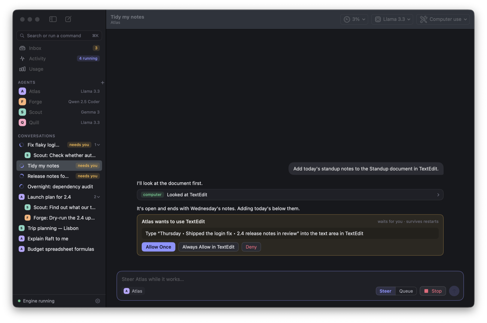

# Computer use

An agent with computer use on can see and work the apps you choose, one window at a time, in the background while you keep working.

<p align="center"></p>

## Turning it on

1. Open an agent and scroll to **Computer use**. Switch it on and add the apps it may use.
2. Press **Grant…** next to Accessibility. macOS opens System Settings; switch pi² on there. Do the same for Screen Recording if you want the agent to get pictures. Reopen pi² afterwards.
3. Ask the agent to do something in one of those apps. Conversations it already has pick up the change at their next message.

Start with something harmless, such as TextEdit.

## How it works

The engine decides what is allowed and asks for approval. The app does the seeing and clicking, because macOS gives the permissions for those to the app. So pi² has to be open.

- **Controls first.** The agent is given a numbered list of the front window's buttons, fields, rows and menus, read through the accessibility API. It acts on a control by its number. That is exact, and it does not need the app in front.
- **Pictures second.** If its model takes images, it also gets a screenshot, and can act on a point in it when something is not in the list. A model that cannot see images works from the list and the window's text, and needs no Screen Recording permission.
- **Every action answers with the window as it is afterwards**, so the agent checks each step before the next.
- **Only the two newest pictures are sent to the model.** The conversation keeps them all; expand a computer step to see what the agent saw.

The actions are: list the apps it may use, open an app, look at a window, click, type, press a key, scroll, and choose a menu command.

## Asking first

With **Ask before each action** on, which is the default, every click, keystroke and menu command waits for you. The request says what will happen in words, such as "Click the “Send” button in Mail". You can allow once, allow that app for the rest of the conversation, or deny. Looking is never asked about.

While an agent is acting, a pill at the top of the screen says so. Its Stop button, or pressing Esc twice, stops the run.

## What it will not do

These hold whatever the agent or its instructions say. They are checked in the engine and again in the app.

- **Terminals, script editors and password managers cannot be added.** Typing in a terminal is running a command, without the approval the command tool has.
- **Browsers and System Settings are look-only.** A browser holds every account you are signed in to.
- **Password fields are never typed into.**
- **The Apple menu is off limits.**
- **pi² itself cannot be a target**, so an agent cannot approve its own requests.

The agent is also told that what it reads in a window is content, not instructions. That lowers the risk from text planted in a document or a page; it does not remove it. Keep "Ask before each action" on for anything that matters.

## Limits

- pi² must be open.
- A click at a bare point, not on a listed control, is ignored by some apps while they are in the background. Such clicks go through accessibility where they can, and the agent is told when a click changed nothing.
- Apps with little accessibility support may not be workable.
- Whatever the chosen windows show is sent to the agent's model.
- macOS ties the permissions to the exact build. After rebuilding a development build, remove pi² from the Accessibility and Screen Recording lists and grant it again.

## For developers

The code that touches the screen is its own module, `app/Sources/ComputerKit`. It has no automated test. Try it by hand against one app with the probe, which is built separately and is not part of the app:

```bash
cd app && swift build --product pi2-probe
```

```bash
.build/debug/pi2-probe --only com.apple.TextEdit --out /tmp/probe '[{"action":"open_app"},{"action":"type","text":"hello"}]'
```

The probe uses the permissions of the terminal it runs from, and touches only the app named by `--only`. It is kept out of the app on purpose: a flag on the app itself would let any program borrow the app's Accessibility permission.
