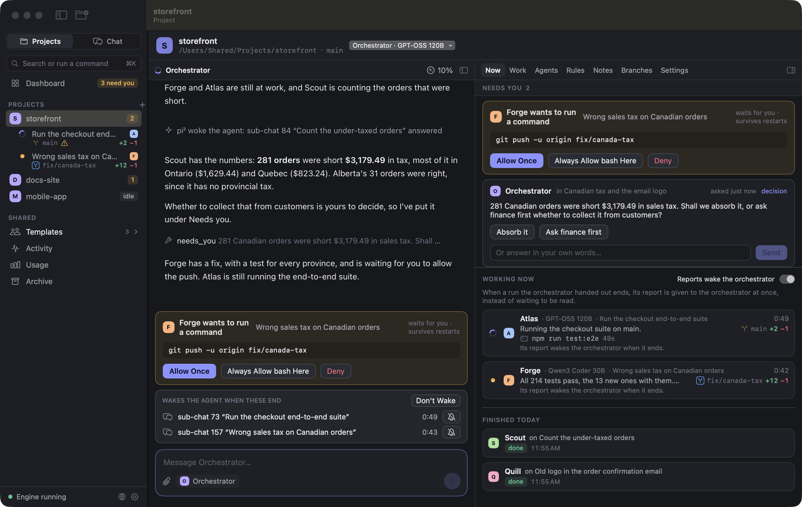
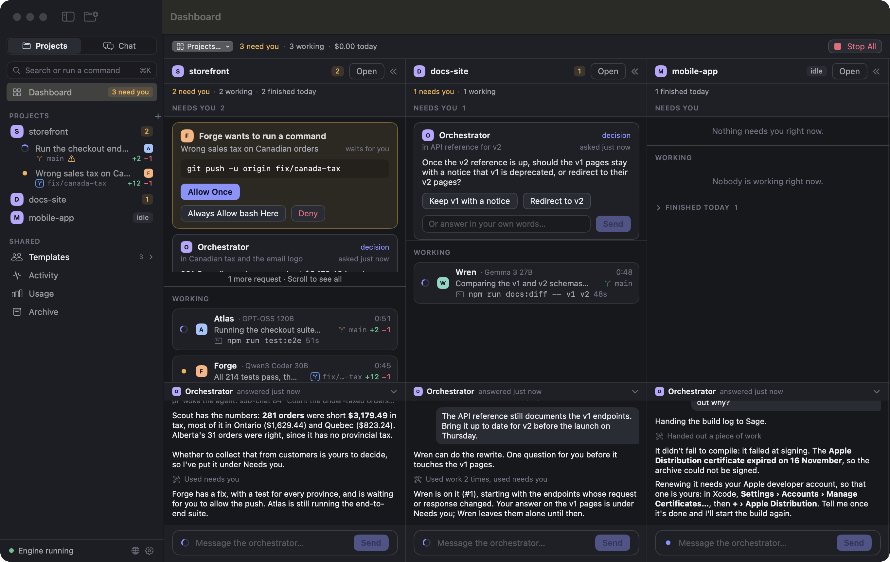

# Using pi²

This page is for the person using pi². It says what each part of the app is for and how to use it, in the words the app uses. For how pi² is built, see [architecture.md](architecture.md) and [projects.md](projects.md).

## Contents

- [The idea](#the-idea)
- [The window](#the-window)
- [Projects](#projects)
- [The orchestrator and its agents](#the-orchestrator-and-its-agents)
- [The hub](#the-hub)
- [The board's tabs](#the-boards-tabs)
- [Panes](#panes)
- [The Dashboard](#the-dashboard)
- [Needs you](#needs-you)
- [What the orchestrator may do without asking](#what-the-orchestrator-may-do-without-asking)
- [Rules](#rules)
- [Notes](#notes)
- [Work](#work)
- [Limits](#limits)
- [Schedules](#schedules)
- [Shared: Templates, Activity, Usage and the Archive](#shared-templates-activity-usage-and-the-archive)
- [Chat mode](#chat-mode)
- [Continue with an Agent](#continue-with-an-agent)
- [Away from the window](#away-from-the-window)
- [Your data from before projects](#your-data-from-before-projects)
- [Devices (preview)](#devices-preview)
- [Keys](#keys)

## The idea

pi² is a home on your Mac for AI agents that keep working. Every step an agent takes is saved as it happens, so a crash, a restart or quitting the app does not lose its work: it picks up where it stopped.

Work is organised in **projects**. A project is a folder, an **orchestrator** you talk to, and the **agents** that do the work it hands out. You tell the orchestrator what you want; it plans the work with you, gives each piece to an agent, reads what comes back and tells you what was done. Anything that is yours to decide waits for you under **Needs you**.

For a question that needs no folder and no agents, there is **chat mode**, a plain chat with an assistant.

Connecting models, choosing which show in the menus and the model new agents start on are in [models.md](models.md).

## The window

The sidebar has, from the top:

- **Projects** and **Chat**, the two sides of the window (⌘1 and ⌘2).
- **Search or run a command** (⌘K): finds projects, conversations, agents and messages, and runs any command of the app.
- **Dashboard**, with a count of what needs you across all projects.
- **Projects**: one row each, with a count of what needs you or how many agents are working. The open project unfolds to show the agents working now and its other conversations. **+** makes a new project.
- **Shared**: Templates, Activity, Usage and the Archive, which are not any one project's.
- At the foot, whether the engine is running (and whether it is keeping the Mac awake), the browser, and Settings.

With nothing chosen, the window shows your one project's hub, the Dashboard when you have several, or, with none yet, a page to make your first.

## Projects

A project is made from a folder in one step: **New Project…** (the **+** by Projects in the sidebar), then choose the folder. pi² makes the project, names it after the folder, and gives it an orchestrator. A project can also have no folder; its agents then work in a folder pi² keeps for the purpose.

- **One folder, one project.** A git repository is one project, with its subfolders and worktrees.
- **Rename** or **Archive** a project from its row's menu in the sidebar. An archived project leaves the sidebar and nothing new starts in it; its conversations, agents, rules and notes stay as they were. Restore it from the Archive.
- **Delete** it from its Settings tab. Its conversations keep their history and show in the Archive under its name, but its agents can no longer be started, and their schedules are held. This cannot be undone.
- The project's own row in the sidebar is its orchestrator's: a spinner while it works, a dot while it waits for you, an hourglass while it waits for a provider's limit, and **Stop the Orchestrator** in its menu.

## The orchestrator and its agents

**The orchestrator** is the agent you talk to about the project. It has one conversation with you, which goes on for as long as the project does. It hands work to the project's other agents, keeps the project's work list, and can change the project itself (make an agent, add a rule, change a setting). Each change it makes shows in its conversation as a line with **Undo**.

**The project's agents** each have their own model, instructions, tools and limits. Each piece of work handed to one opens a **sub-chat** of the conversation that handed it out, where you can watch it work and write to it. When it ends, its answer is a **report** to the orchestrator.

**Templates** are agents kept outside any project, under Shared. A project's agents are made from them, or by hand; changing a project's agent changes that project only. When its template changes, **Update from Template…** on the agent's row shows what would change and brings it up to date.

A conversation with the orchestrator that has grown long can be summarised, or started afresh with **Start Fresh…** (from the context meter in the conversation's header). The new conversation begins with the project as it stands: who is working, what waits for you, the reports not yet read and the work, with the project's rules and notes. The old one is kept to read, linked from the new one.

## The hub

Choosing a project shows its **hub**: the conversation with the orchestrator on the left and the **board** on the right.

- **The bar** above them shows the project's folder and branch, the orchestrator's model and thinking level (changing either changes the orchestrator from its next message), and how much of your plan's week is used.
- **Each panel folds**: ⌥⌘[ folds the conversation, ⌥⌘] the board. With the conversation folded, a strip along the bottom of the board keeps the orchestrator's last words and a field to answer it. A window too narrow for both folds the board by itself, and says so.
- **An agent's conversation** opens in place of the board when you click its row in the sidebar or on the board, with **Back to the Board** to return. Its header has a menu to stop it, rename it, export it, archive it or delete it, and its agent's model and thinking level. A sub-chat's header has **Parent**, for the conversation that handed it its work.
- **New Conversation** on an agent's row in the Agents tab, or ⌘N and a name, starts a conversation with one of the project's agents. For the orchestrator, this is Start Fresh.

Each project opens as you left it: which panels were folded, which tab, and its panes.

## The board's tabs

- **Now**: what needs you, answered in place; who is working now, with what each is doing and for how long, and Stop; and what finished today, marked when the orchestrator has not read it yet. The switch **Reports wake the orchestrator** is here too ([Limits](#limits)).
- **Work**: the project's work list ([Work](#work)).
- **Agents**: the orchestrator, with what it may do without asking; the project's other agents, each with its page, **New Conversation**, **Update from Template…** and **Make Orchestrator…**; **New Agent** and **From a Template**; and the agents the orchestrator removed, with **Restore**.
- **Rules**: the project's rules ([Rules](#rules)).
- **Notes**: what the project's agents keep about it ([Notes](#notes)).
- **Branches**: the git branch each of the project's conversations works on, how it stands, and the worktrees left behind by archived and deleted conversations, with **Refresh**.
- **Settings**: the project's name and folder, its GitHub repository, the orchestrator's model and when its conversation is summarised, whether reports wake it, its limits, its schedules, and archiving and deleting it.

## Panes

The board's side of the hub can be split into panes, so you can watch and write to two or three agents at once beside the orchestrator. **View › Split Right** (⌘D) and **Split Down** (⇧⌘D) add a pane, which offers the project's working agents first, then its other conversations. **Close Pane** (⌃⌘W), **Next Pane** and **Previous Pane** (⌘] and ⌘[), **Even Out Panes** and the ready-made layouts work on them. A conversation opened with ⌥ held, or dragged from the sidebar, goes to a new pane. The board shows in one pane at most; closing the last pane brings it back.

## The Dashboard

The Dashboard shows the projects you tick under **Projects…**, a column each. A column has, under its header, one line of what needs you, who is working, what finished today and what the project spent today; then what needs you, answered in place; who is working; what finished today; for a GitHub project, the pull requests waiting to be merged; and at the bottom, a window onto the conversation with the orchestrator and a field to message it. **Open** takes you to the project's hub.

The line across the top counts what needs you in all (⌥⌘0 brings the first into view), who is working and what was spent today (which opens Usage), with each subscription's plan windows. **Stop All** stops every run in the projects shown, after asking. Notices that a subscription's limit was reached show under that line, with **Show Usage** and **Dismiss**, and so does the notice that the engine restarted after stopping unexpectedly.

Columns can be dragged into your own order, folded to a narrow strip, and reached from the keyboard: ⌥⌘1 to ⌥⌘9 put the cursor in a column's field.

## Needs you

Everything that waits for you, from every project, is one list. It shows on each project's Now tab, in each Dashboard column, in the menu bar item, in the Dock's badge and as notifications, and as a card in the conversation where the agent asked. Answer it in any of those places; once answered, it is gone from all of them.

- **An approval**: an agent wants to run a command, change a file, use an app, act in the browser, set a schedule or make a worktree. **Allow Once**, **Deny**, or an **Always Allow …** that stops asking for the same thing in that conversation, or for commands that start the same way in that folder ([allowed-commands.md](allowed-commands.md)). The agent waits for your answer, after a restart too.
- **A question**: type an answer. A question an agent asks with **needs you** does not hold it up: it carries on with what does not depend on your answer, and your answer reaches it when you give it. A question it cannot work without holds it until you answer.
- **A decision**: choose one of its buttons, or answer in your own words.
- **More reach**: the orchestrator wants to let an agent do more (full access, an app, a new allowed command), or to raise a limit. Agents can only ask for these. **Allow** makes exactly the change shown; **Refuse** changes nothing.
- **A proposed rule**: **Accept**, **Edit…** or **Refuse**. It shows on the Rules tab too.
- **A start past a limit**: **Start Anyway** or **Leave It** ([Limits](#limits)).
- **A switch that is off**: the orchestrator wants to do something you asked it to ask about first. **Allow Once** or **Deny**.

## What the orchestrator may do without asking

On the Agents tab, under the orchestrator, a switch for each kind of change: start agents, file work, close work, make and change agents, add rules, merge pull requests, release, and go past limits. A new project lets it do the first five without asking, and asks you before a merge, a release or going past a limit. A switch that is off makes each such thing wait for you under Needs you.

**Release** is a policy: nothing pi² does is held back by it, but the orchestrator is told to ask you before releasing anything. Merging is held back only when it is done through pi²'s own work list; an agent that may run commands without asking could still merge with a command of its own.

Whatever the switches say, an agent can only ask for more reach: it cannot give itself or another agent more access, a new app, a new allowed command, or a higher limit.

## Rules

A rule is a line your project keeps to, such as "Never merge without a review by another agent". pi² sends it word for word, in full, to the orchestrator or to every agent, at every request, so it holds however long a conversation runs. Each rule binds the orchestrator or every agent; their order is only the order they are shown in.

On the Rules tab, add a rule, edit one in place, move it, choose whom it binds, or remove it. The tab says about how many tokens the rules add to every request. You can also tell the orchestrator to keep something as a rule: it adds it (or proposes it, if its switch is off), and the change shows in its conversation with Undo.

## Notes

Notes are what the project's agents keep about it as they work: facts, decisions, preferences. They are given to the agents of the project whose memory is on. On the Notes tab you can read, search, correct and remove them, and add your own. A note can be for one agent only; **Share with the Project** gives it to every agent.

## Work

Each project has one work list, on its Work tab. It is kept in one of two ways:

- **Kept by pi²**, the default. **New Work** adds a piece of work; the orchestrator and the agents add to it too.
- **A GitHub repository's issues and pull requests**, once you attach one on the Settings tab. pi² uses the `gh` command, signed in as you, and keeps no token of its own.

Either way, a piece of work is open, in progress, waiting, blocked, done or dropped, and the list is grouped by those, each group folding with a click on its heading. Open a piece to read it, add a note, or act on it: **Give to** an agent (which starts it working on it, in a git worktree of its own when the folder is a repository), **Release**, **Resume**, **Classify**, **Close as Done**, **Close as Dropped**, **Reopen**, **Edit**.

For a GitHub project, pull requests come first, with their checks and what reviewing agents found. An opened pull request has **Diff**, **Merge** and **Send Back**, which posts your reason on it and gives it to the agent that opened it. If pi² was cut off while writing to GitHub and cannot tell whether the write happened, the Work tab says so: look at the repository, then choose **It Happened** or **It Did Not**.

An agent that lists the work with its `work` tool is given the open issues and the open pull requests, and only a count of the merged and closed ones: it asks for those when it needs them, a page at a time.

## Limits

A project's limits, on its Settings tab, hold back new work, not work already running:

- **Plan window used**: no agent starts while a window of the subscription it would run on is this much used. A new project starts at 90%.
- **Spent today**: no agent starts once the project's conversations, sub-chats included, have cost this much today.

A start past a limit is refused, and a card under Needs you says why: **Start Anyway** starts that one, **Leave It** drops it. Past a limit, reports do not wake the orchestrator either; they wait for its next turn. pi²'s own **daily budget**, on the Usage page, applies on top, to everything.

**Reports wake the orchestrator** (on the Now and Settings tabs) decides whether a finished piece of work wakes the orchestrator at once, so it can read the report and hand the work on, or waits for its next turn. It is off for a new project; the orchestrator can ask for its own hand-offs to wake it.

## Schedules

A schedule starts a conversation by itself: every day, every week, every few minutes, or once. A project's schedules are on its Settings tab, with **New Schedule…**, **Edit…**, **Run Now**, **Last Run** and **Delete**. Each names one of the project's agents (the orchestrator unless you choose another), and each run is a new conversation of the project, listed with its other conversations. A run with the orchestrator is a conversation of its own, beside the one you have with it.

An agent allowed to schedule its own work can set a schedule when you ask it to check something later; you approve each one before it exists ([schedules.md](schedules.md)). A template's schedules are on its page under Templates.

## Shared: Templates, Activity, Usage and the Archive

- **Templates**: the agents kept outside any project. Open one to change its settings, duplicate it or delete it; **New Template** makes one. A project's agents made from a template keep their own settings until you update them.
- **Activity**: what keeps running apart from the agents: commands an agent left running in the background, each with **Output**, **Open** and **Stop**, and models running on this Mac. The agents at work are on each project's Now tab and on the Dashboard.
- **Usage**: what was spent, by model, by agent, by project today and by conversation, the last 14 days, your plan's limits, and the **Daily budget**. Cost is an estimate for models you pay for by use; subscriptions and local models count tokens only.
- **The Archive**: conversations put away, to read (**Open**), **Restore** or **Delete**; archived projects, to restore; and deleted projects, whose conversations can each be put back into the project of their folder with **Restore to a Project…**, which shows first what it would do. pi² can also archive conversations nothing has happened in for a week, a month, three months or a year ([archive.md](archive.md)).

## Chat mode

**Chat** (⌘2) is a plain chat with an assistant, as in ChatGPT or Claude, with nothing to set up: no folder, no agents, no approvals. **New Chat** (⌘N) starts one. Each chat has its own model; the assistant can search the web and read pages unless you turn **Web** off for that chat, and can write a document for you. **Try Again** and **Edit** make new versions of an answer, which you can step between. Chats can be pinned, renamed, searched, archived and deleted. Chat mode has instructions and a memory of its own, in **Settings › Chat** ([chat.md](chat.md)).

## Continue with an Agent

When a chat turns into work, **Continue with an Agent…** (in the chat's header and its menu) hands it to a project: choose the project (or **New Project…**), and the orchestrator or another of its agents, and say what it should do next. To the orchestrator, the chat goes into its conversation as your message; to another agent, it starts a new conversation in the project. The agent is given the chat's messages, files and pictures, and the two conversations link to each other.

## Away from the window

- **The menu bar item** shows what needs you and what is running, with a field that asks in a new chat.
- **Quick Ask** (⌃⌥Space, from any app) asks in a new chat and shows the answer in place; **Open in pi²** opens it in chat mode.
- **Closing the window** leaves pi² in the menu bar, and the engine can keep going after you quit.
- **While agents work**, pi² keeps the Mac from going to sleep by itself (the display can still sleep). **Settings › General › Power** turns it off, or on for battery too.

## Your data from before projects

Versions of pi² before projects had a list of agents and a list of conversations. The first time a version with projects only started, it moved everything into projects by itself:

- **A copy first.** Before changing anything, it made a copy of your data in the `backups` folder of pi²'s data folder, `~/Library/Application Support/pi2/backups`, and a notice said where, once, with **Show in Finder**. If the copy could not be made, nothing was moved, a banner said why, and pi² tried again at its next start.
- **Conversations** went into the project of their folder: one project per folder, a repository's subfolders and worktrees with it, and those with no folder into a project named "No folder". Archived conversations stayed archived. Chats stayed in chat mode. Nothing was deleted.
- **Agents** became templates, and each project got its own copy of every agent its conversations used, with the same settings, allowed commands and variables. Each conversation runs as its project's copy.
- **Each project's orchestrator** is the agent of its most recent conversation that handed out work, and that conversation is the orchestrator's; a project with none got a new orchestrator, whose conversation starts the first time you open it. Projects made this way have reports waking the orchestrator, and no limits.
- **An agent's notes** went to each project with a copy of it, for that copy alone, until you share them on the Notes tab.

The copy holds every conversation, agent, project, note, rule and work item, and your settings. It does not hold keys, sign-ins and variables' values (they stay in the Keychain), chat mode's documents, worktrees or downloaded local models. **Settings › Storage › Restore From Backup…** restores it, and replaces everything done since. The move cannot be switched back: the old screens are gone, and only a version from before projects, restored from that copy, has them.

## Devices (preview)

**Settings › Devices** is where an iPhone is paired with this Mac, for pi² for iPhone, which is not given out yet. It is a preview: until **iPhone (preview)** is on, the tab holds that switch alone, nothing runs and no device can pair. With it on:

- **Reach from an iPhone** lets paired devices reach this Mac while pi² runs; off, they stay paired and can do nothing. **Reach through pi²’s relay** carries them from any network, encrypted end to end, with the relay’s address and whether this Mac is registered there; off, only home and private networks. **Find on this network** talks directly at home; **Direct from any address** takes direct connections from any address, not only home and private networks.
- **Pair an iPhone…** shows a code to scan with pi² on the iPhone, good for one iPhone and five minutes, and kept out of screen sharing and recordings. The iPhone then shows six digits: type them on the Mac to pair it. Nothing pairs until they match. If another device tries the same code, the code is closed and you start again. An iPhone with the name and model of one already paired can **Replace** it.
- Each paired device shows when it was paired and last seen, and how. **What It Did…** is its log: every answer and change, connection and refused try, for 90 days. **Rename…** and **Revoke…** are in its … menu. A device this Mac refused five times in ten minutes is suspended until you **Resume** it. When Face ID is set up again on an iPhone, accept the new key only if you did it yourself.
- Lost an iPhone away from the Mac? Erase it with Find My, then revoke it here.
- While a device is connected, the menu bar item and the foot of the sidebar say so (*Alex’s iPhone · through the relay*). With notifications on in **Settings › General**, the Mac also tells you when a device pairs, when its Face ID changes, when it is suspended, and when it widens what agents may do.

## Keys

| Keys | Does |
|---|---|
| ⌘1, ⌘2 | Projects, Chat |
| ⌘K | Search or run a command |
| ⌘N | A new conversation with one of the shown project's agents; a new chat in chat mode |
| ⌥⌘[, ⌥⌘] | Fold the conversation, fold the board |
| ⌘D, ⇧⌘D, ⌃⌘W | Split right, split down, close pane |
| ⌘], ⌘[ | Next pane, previous pane |
| ⌥⌘0 | On the Dashboard: the first thing that needs you |
| ⌥⌘1 to ⌥⌘9 | On the Dashboard: a column's message field |
| ⌥⌘. | On the Dashboard: Stop All |
| ⌘. | Stop the conversation that has the keyboard |
| ⌃⌘A | Archive the conversation |
| ⇧⌘B | The browser |
| ⌃⌥Space | Quick Ask, from any app |
| Return, Shift-Return | Send, a new line |
