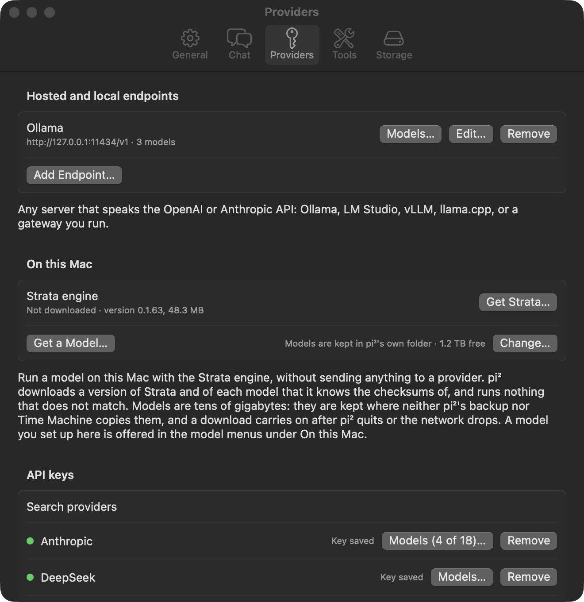

# Models and providers

This page is for the person using pi². It says how to connect the models you already have, choose which of them show in the menus, add one pi² does not know yet, and choose the model new agents start on. Models that run on this Mac, with nothing sent anywhere, have pages of their own: [getting one](local-models.md) and [running it](local-models-running.md).

## Connecting a model

Everything here is in **Settings › Providers**, in four sections:

- **Subscriptions**: sign in with a plan you already pay for (**Sign In…**), such as Claude Pro or Max, a ChatGPT subscription, GitHub Copilot or xAI. Each provider decides whether its subscription may be used from another app; check their terms.
- **Hosted and local endpoints**: **Add Endpoint…** for any server that speaks the OpenAI or Anthropic API: Ollama, LM Studio, vLLM, llama.cpp, or a gateway you run. **Edit…** and **Remove** change it later.
- **On this Mac**: get the Strata engine and a model, and run it locally ([local-models.md](local-models.md)).
- **API keys**: **Add Key…** for any of 40 or so providers, with a search field to find one.

Keys and sign-ins are kept in the macOS Keychain, never in pi²'s files. A new installation's welcome offers the common sign-ins, and an Ollama or LM Studio server it finds running on this Mac, so you can connect one before anything else.

Each agent can use a different model, and so can each chat.

## Choosing which models show

A provider can offer dozens of models. **Models…** on its row (it shows how many are ticked, as in **Models (4 of 18)…**) lists them, and only the ticked ones appear in the model menus. Search the list by name or id, then **Select Matches** or **Deselect Matches**; **Select All** and **Deselect All** work on the whole list; **Newest Only** keeps one of each family. A hidden model that a conversation or agent already uses keeps working.

## Automatically discovering subscription models

With a saved ChatGPT or Claude sign-in, or an OpenCode Go key, pi² checks for new models in the background at startup, after sign-in or a key change, and every six hours. Models you hid stay hidden; settings you chose for a model added by hand take precedence.

Claude listing depends on the subscription allowing it. OpenCode Go listing requires **Models › Read** for restricted or service-account keys. If listing is refused or unavailable, your catalog and manually added models remain, along with cached discoveries that still match your credential; pi² retries after fifteen minutes. Claude token rotation or a Go key change invalidates its discovery cache, so offline you may see only the catalog until listing succeeds again. Other providers keep their existing behavior.

Go's listing must identify a chat model and its supported protocol. Entries without enough information to route safely are skipped; Add by ID remains available. Capabilities the provider does not report are inherited from a catalog model, and newly discovered models have no known price until the catalog includes them.

## Adding a model by its ID

A model released after your copy of pi² can be added by its id, on the sign-in or key you already have. In the provider's **Models…**, choose **Add a Model by ID…** and type the id the provider gives it (`gpt-6.2-sol`, say), then **Look Up**.

pi² takes its context size, longest answer, thinking levels, whether it sees pictures and the API it speaks from the newest model of the same family it knows (**Based on**), shows them, and lets you change any of them before **Add Model**. The model is then in every model menu, marked "added by hand", and kept until you remove it or pi²'s own list comes to have it, which then takes its place.

- **Its price is not known**, so Usage counts its tokens without a cost, and it does not count towards the daily budget.
- **If the provider does not offer the model** to your sign-in or key, a conversation that uses it stops with the provider's message, and says the model was added by hand.
- **Remove it** in the same list. A conversation still set to it stops at its next turn and asks you to choose another model.

## Asking the provider

**Ask** the provider instead, in the same window (**Ask Anthropic…**, say), and pi² asks it which models your sign-in or key can use, then lists the ones pi² does not know, to add as above with what the provider says of each (its name, context size, pictures and thinking levels, where it says them). It asks only the provider's own address, with your own credential, and the window says which address. What can be asked:

| Provider | With | What is asked |
| --- | --- | --- |
| OpenAI Codex | ChatGPT sign-in | `chatgpt.com/backend-api/codex/models`, the list the Codex CLI shows |
| OpenAI | API key, or ChatGPT sign-in | `GET /v1/models` on api.openai.com |
| Anthropic | API key, or Claude sign-in | `GET /v1/models` on api.anthropic.com |
| Google | API key | `GET /v1beta/models` on generativelanguage.googleapis.com |
| Mistral, Groq, DeepSeek, xAI and the others that speak OpenAI's API | API key | `GET /models` at the provider's address |
| OpenCode Go | saved API key | `GET /inference/go/v1/models` on opencode.ai; account-filtered with the key |
| Radius | key or sign-in | its own list, which pi² also fetches at each start |

GitHub Copilot, Amazon Bedrock, Vertex AI, Azure OpenAI and sign-ins other than those above cannot be asked: the window says so, and a model is added by its id. Whether a subscription sign-in may list models is up to the provider; if it refuses, the window shows its answer.

## The model new agents start on

A new agent has no model of its own until you choose one in its settings: it shows **App default** and runs on the **Default model for new agents**, in **Settings › General**, with the thinking level chosen there. Changing that setting changes what every such agent starts its next conversation on, and any work handed to it; a conversation already started keeps its model. Left at **The model used last**, the default is the model you last picked in a conversation.

If the chosen model is switched off or its provider signed out, agents start on the model used last (else the demo model) until it is back, and Settings says so.

The orchestrator's model and thinking level are also in its project's bar, and on the project's Settings tab. Chat mode has its own default, in **Settings › Chat** ([chat.md](chat.md)).

## Without a model

Until you connect one, pi² uses a scripted demo model, which shows how things work but cannot answer.
